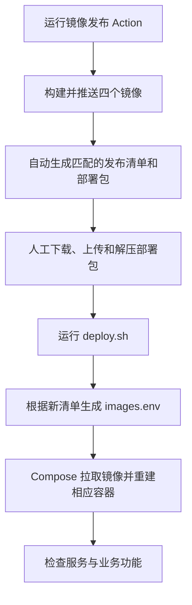
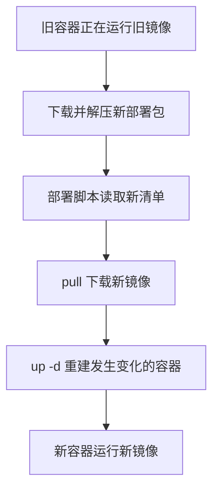

# 测试部署上线SOP

文档职责：记录 CausalAgent 测试/预发环境通过腾讯云镜像发布包部署的团队步骤与验收边界。

适用范围：发布包已生成，成员需要部署到测试/预发服务器时使用；生产发布需遵循生产环境单独确认的配置和步骤。



## 更换运行镜像流程



## 详细流程

### 发布包准备

本次发布包是：

```Plain Text
causalagent-release-2026.10.16-0b79676-38870125961-1.zip
```

ZIP 内包含：

```Plain Text
causalagent-release-2026.10.16-0b79676-38870125961-1.tar.gz
images.lock.json
release.manifest.json
```

服务器上需要解压内层 `tar.gz`，得到类似：

```Plain Text
/tmp/causalagent-2026.10.16-0b79676-38870125961-1/bundle/
```

这个目录中应包含：

```Plain Text
deploy/
observability/
scripts/
docker-compose.staging.yml
docker-compose.prod.yml
release.manifest.json
images.lock.json
```

### 普通配置和密钥配置

服务器上使用两份文件：

```Plain Text
/etc/causalagent/config/production.env
/etc/causalagent/secrets/causalagent.env
```

文件名 `production.env` 只是文件名，**不决定部署生产环境**。

真正选择 staging 的变量是：

```Plain Text
export CAUSALAGENT_COMPOSE_FILE=docker-compose.staging.yml
```

普通配置文件中必须使用当前项目名：

```Plain Text
COMPOSE_PROJECT_NAME=causalagent-staging
```

密钥文件只保存密钥，权限应为：

```Plain Text
root:3000
0640
```

上传权限不足时，先上传到 `/tmp/upload`，再执行：

```Plain Text
install -D -o root -g root -m 0640 \
  /tmp/upload/production.env \
  /etc/causalagent/config/production.env

install -D -o root -g 3000 -m 0640 \
  /tmp/upload/causalagent.env \
  /etc/causalagent/secrets/causalagent.env
```

### 确认旧服务项目名

你已经执行：

```Plain Text
docker compose ls
```

结果确认项目名是：

```Plain Text
causalagent-staging
```

因此新部署必须继续使用这个项目名。否则 Compose 可能创建另一套容器和新卷，并产生端口冲突。

### 设置部署变量

服务器终端中执行：

```Plain Text
export CAUSALAGENT_CONFIG_FILE=/etc/causalagent/config/production.env
export CAUSALAGENT_SECRET_FILE=/etc/causalagent/secrets/causalagent.env
export CAUSALAGENT_COMPOSE_FILE=docker-compose.staging.yml
export COMPOSE_PROJECT_NAME=causalagent-staging
```

找到部署包：

```Plain Text
find /tmp -maxdepth 6 \
  -path '*/bundle/release.manifest.json' \
  -print
```

然后设置实际目录，例如：

```Plain Text
export BUNDLE_DIR=/tmp/causalagent-2026.10.16-0b79676-38870125961-1/bundle
export RELEASES_DIR=/opt/causalagent-staging/releases
```

从 manifest 读取发布 ID，并确认目标目录尚不存在，避免部署脚本向旧目录叠加复制文件：

```Plain Text
RELEASE_ID="$(python3 -c 'import json,sys; print(json.load(open(sys.argv[1]))["release_id"])' "$BUNDLE_DIR/release.manifest.json")"
test ! -e "$RELEASES_DIR/$RELEASE_ID" || { echo "release directory already exists: $RELEASE_ID" >&2; exit 1; }
```

创建发布目录：

```Plain Text
mkdir -p "$RELEASES_DIR"
```

检查文件：

```Plain Text
test -f "$BUNDLE_DIR/scripts/deploy.sh" && echo "deploy.sh OK"
test -f "$BUNDLE_DIR/docker-compose.staging.yml" && echo "staging compose OK"
test -r "$CAUSALAGENT_CONFIG_FILE" && echo "config OK"
test -r "$CAUSALAGENT_SECRET_FILE" && echo "secret OK"
```

部署前记录旧版本的实际路径；部署脚本会在 Compose 启动命令成功后更新 `current`，这早于下面的运行状态验收：

```Plain Text
PREVIOUS_RELEASE="$(readlink -f "$RELEASES_DIR/current")"
test -d "$PREVIOUS_RELEASE"
```

记录 `PREVIOUS_RELEASE` 的实际路径到本次发版记录；不要依赖 SSH 会话结束后仍存在的 shell 变量。

### 执行部署

确认上面四项都显示 `OK` 后执行：

```Plain Text
bash "$BUNDLE_DIR/scripts/deploy.sh" \
  "$BUNDLE_DIR" \
  "$RELEASES_DIR"
```

脚本实际执行以下动作：

1. 读取发布版本号。

2. 将部署包复制到：

```Plain Text
/opt/causalagent-staging/releases/<release_id>
```

1. 根据 `release.manifest.json` 生成 `images.env`。

2. 更新 `current` 符号链接。

3. 使用 staging Compose 文件执行 `docker compose pull`。

4. 使用同一个项目名执行 `docker compose up -d`。

### 原服务会发生什么

执行 `pull` 时，旧容器继续运行。

执行 `up -d` 时，Compose 会比较新旧配置：

- 未变化的容器通常继续运行。

- 镜像或配置变化的容器会被停止并重新创建。

- 可能出现短暂服务中断。

- 数据卷不会因为该命令自动删除。

- `db-bootstrap` 可能执行数据库迁移。

- 不保证正在执行的任务完全无中断。

只要项目名保持为：

```Plain Text
causalagent-staging
```

并且 Compose 卷定义没有改变，原有 staging 数据卷会继续使用。

不要执行：

```Plain Text
docker compose down -v
```

### 部署后检查

```Plain Text
export RELEASE_DIR="$(readlink -f "$RELEASES_DIR/current")"
export COMPOSE_FILE="$RELEASE_DIR/docker-compose.staging.yml"
```

执行静态检查：

```Plain Text
bash "$RELEASE_DIR/scripts/verify.sh" "$RELEASE_DIR"
```

`verify.sh` 检查发布文件和配置，不验证运行中服务是否健康；不要把它输出的 `deployment verified` 单独当作发版验收通过。后续命令使用 `set -euo pipefail` 或逐项检查退出码，避免分号串联掩盖失败。

查看容器状态：

```Plain Text
set -euo pipefail
docker compose \
  --env-file "$CAUSALAGENT_CONFIG_FILE" \
  --env-file "$RELEASE_DIR/images.env" \
  -f "$RELEASE_DIR/docker-compose.staging.yml" \
  ps --all --format json | \
  python3 -c 'import json,sys; rows=(json.loads(line) for line in sys.stdin if line.strip()); [print("{}\t{}\t{}\t{}\t{}".format(r.get("Service","?"),r.get("State","?"),r.get("Health",""),r.get("ExitCode",""),r.get("Image","?"))) for r in rows]'
```

该汇总应包含所有服务；检查完容器状态后再单独运行网关请求，确保每一步的退出状态都能被判断。

检查 staging 网关的服务器本机响应；该检查不代表外网访问、登录或业务流程已验证：

```Plain Text
curl -fsS --max-time 10 -o /dev/null -w 'gateway_http=%{http_code}\n' http://127.0.0.1:8088/
```

重点确认：

- `db-bootstrap` 成功退出。

- `cdfm-weights-seed` 成功退出。

- `app`、`worker`、`causal-mcp`、`gateway` 等服务为运行或健康状态。

- 实际容器使用的是本次发布清单中的 digest 镜像。

- 应用容器能读取 `/run/secrets/causalagent.env`。

- 外部访问、登录、任务创建、SSE 和真实模型调用正常。

外部访问和业务流程只有在存在授权测试账号及明确验收步骤时才执行；否则逐项标为未验证，不要猜测账号或凭据。

如果部署命令失败，不要删除发布目录，也不要执行 `down -v`。先保留错误输出。

创建本次上传专用目录时，将完整绝对路径记入本次发版记录；例如 `/tmp/causalagent-release-41028097130-1`。全部部署后检查通过后，从记录中取出这一路径赋给 `UPLOAD_DIR` 再清理，不要用通配符生成待删除路径：

```Plain Text
set -euo pipefail
: "${UPLOAD_DIR:?set the exact directory recorded for this upload}"
test -d "$UPLOAD_DIR" && test ! -L "$UPLOAD_DIR"
UPLOAD_DIR="$(realpath -e -- "$UPLOAD_DIR")"
test "$(dirname -- "$UPLOAD_DIR")" = /tmp || { echo "unexpected upload directory: $UPLOAD_DIR" >&2; exit 1; }
case "$(basename -- "$UPLOAD_DIR")" in
  causalagent-release-?*) ;;
  *) echo "unexpected upload directory: $UPLOAD_DIR" >&2; exit 1 ;;
esac
rm -rf -- "$UPLOAD_DIR"
```

发版成功结果中列出实际版本目录和当前版本入口，供成员在服务器文件管理器中打开；`current` 的实际目标以 `readlink -f` 验证。注明本次 `/tmp` 暂存目录已清理，不要将其展示为仍可访问的目录。失败时保留暂存包和日志。不要借此清理旧的 `/opt/causalagent-staging/releases` 版本目录。

```Plain Text
本次发版目录：/opt/causalagent-staging/releases/<release_id>
当前运行版本入口：/opt/causalagent-staging/releases/current
current 实际指向：<readlink -f 输出的版本目录>
本次上传暂存目录：/tmp/causalagent-release-<upload-id>（发版成功后已清理）
```
